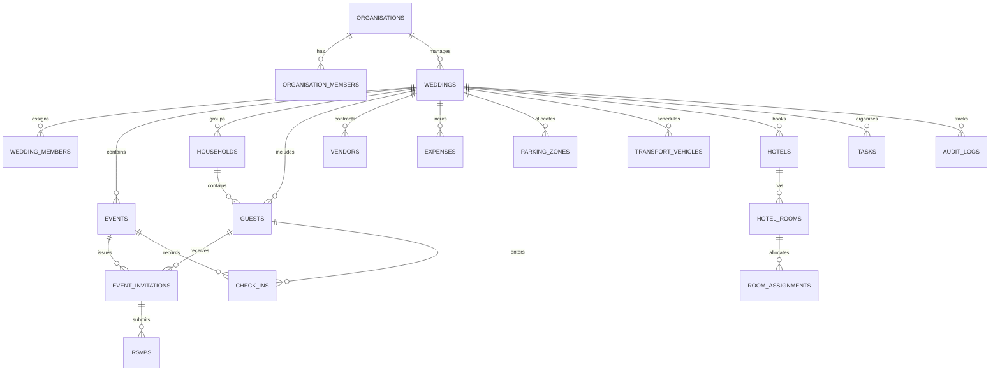

# ShaadiSync — Relational Database Schema Specification

This document defines the complete PostgreSQL relational schema implemented via Supabase for ShaadiSync.

## 1. Schema Entity Relationship Overview

## 2. Table Specifications

### 2.1 Profiles & Multi-Tenancy
- **`profiles`**: `id` (UUID PK, references auth.users), `full_name`, `avatar_url`, `phone`, `created_at`, `updated_at`.
- **`organisations`**: `id` (UUID PK), `name`, `slug` (UNIQUE), `billing_tier` (default 'free'), `created_at`, `updated_at`.
- **`organisation_members`**: `id` (UUID PK), `organisation_id` (FK), `user_id` (FK profiles), `role` (`owner`, `admin`, `member`), `created_at`.
- **`weddings`**: `id` (UUID PK), `organisation_id` (FK), `title` (e.g. 'Aarav & Diya Wedding'), `slug`, `couple_bride_name`, `couple_groom_name`, `start_date`, `end_date`, `primary_city`, `status` (`planning`, `active`, `completed`, `archived`), `created_at`, `updated_at`.
- **`wedding_members`**: `id` (UUID PK), `wedding_id` (FK), `user_id` (FK profiles), `role` (`wedding_lead`, `coordinator`, `checkin_staff`, `viewer`), `created_at`.

### 2.2 Functions (Events) & Venues
- **`venues`**: `id` (UUID PK), `wedding_id` (FK), `name`, `address`, `city`, `google_maps_url`, `contact_phone`, `notes`.
- **`events`**: `id` (UUID PK), `wedding_id` (FK), `venue_id` (FK venues), `name` (e.g. 'Sangeet Night'), `event_type` (`roka`, `haldi`, `mehendi`, `sangeet`, `ceremony`, `reception`, `custom`), `start_time` (TIMESTAMPTZ), `end_time` (TIMESTAMPTZ), `guest_capacity` (INT), `dress_code`, `description`, `created_at`, `updated_at`.

### 2.3 Guests, Households & RSVPs
- **`households`**: `id` (UUID PK), `wedding_id` (FK), `family_name`, `primary_contact_name`, `phone`, `email`, `city`, `notes`.
- **`guests`**: `id` (UUID PK), `wedding_id` (FK), `household_id` (FK households NULLABLE), `first_name`, `last_name`, `side` (`bride`, `groom`, `mutual`), `category` (`family`, `close_friend`, `colleague`, `vip`), `age_group` (`adult`, `child`), `phone`, `email`, `dietary_pref` (`veg`, `jain`, `non_veg`, `vegan`), `allergies_notes`, `invitation_token` (TEXT UNIQUE NOT NULL), `created_at`, `updated_at`.
- **`event_invitations`**: `id` (UUID PK), `event_id` (FK events), `guest_id` (FK guests), `status` (`invited`, `declined`, `confirmed`, `tentative`), `invited_at` (TIMESTAMPTZ), `responded_at` (TIMESTAMPTZ), `notes`, `UNIQUE(event_id, guest_id)`.
- **`rsvps`**: `id` (UUID PK), `event_invitation_id` (FK event_invitations), `attending` (BOOLEAN), `adult_count` (INT default 1), `child_count` (INT default 0), `dietary_notes` (TEXT), `submitted_at` (TIMESTAMPTZ), `ip_hash` (TEXT for rate-limiting protection).

### 2.4 Catering & Vendors
- **`vendors`**: `id` (UUID PK), `wedding_id` (FK), `category` (`caterer`, `decorator`, `photographer`, `makeup`, `dj`, `priest`, `florist`, `transport`, `other`), `business_name`, `contact_name`, `phone`, `email`, `contract_status` (`inquiry`, `quoted`, `booked`, `completed`), `total_contract_amount` (DECIMAL(12,2)), `advance_paid` (DECIMAL(12,2)), `balance_due` (DECIMAL(12,2)), `notes`.
- **`meal_plans`**: `id` (UUID PK), `event_id` (FK events), `vendor_id` (FK vendors NULLABLE), `meal_type` (`breakfast`, `lunch`, `high_tea`, `dinner`), `service_style` (`buffet`, `seated_thali`, `cocktail`), `planned_per_plate_cost` (DECIMAL(10,2)), `confirmed_headcount_override` (INT NULLABLE), `buffer_percentage` (INT default 10), `approved_quantity` (INT).

### 2.5 Budgets & Expenses
- **`budget_categories`**: `id` (UUID PK), `wedding_id` (FK), `name`, `allocated_amount` (DECIMAL(12,2)).
- **`expenses`**: `id` (UUID PK), `wedding_id` (FK), `category_id` (FK budget_categories), `vendor_id` (FK vendors NULLABLE), `event_id` (FK events NULLABLE), `title`, `amount` (DECIMAL(12,2)), `payment_status` (`unpaid`, `partially_paid`, `paid`), `payment_method` (`bank_transfer`, `upi`, `cheque`, `cash`), `due_date` (DATE), `paid_at` (TIMESTAMPTZ), `notes`.

### 2.6 Logistics: Parking, Transport & Accommodation
- **`parking_zones`**: `id` (UUID PK), `wedding_id` (FK), `event_id` (FK events NULLABLE), `name`, `capacity`, `location_instructions`.
- **`parking_assignments`**: `id` (UUID PK), `parking_zone_id` (FK parking_zones), `guest_id` (FK guests), `vehicle_category` (`car`, `suv`, `bus`), `pass_code` (TEXT UNIQUE).
- **`transport_vehicles`**: `id` (UUID PK), `wedding_id` (FK), `vehicle_name`, `vehicle_type` (`sedan`, `innova`, `tempo_traveller`, `bus`), `capacity`, `driver_name`, `driver_phone`.
- **`transport_assignments`**: `id` (UUID PK), `transport_vehicle_id` (FK), `guest_id` (FK), `pickup_location`, `drop_location`, `pickup_time` (TIMESTAMPTZ), `status` (`scheduled`, `picked_up`, `completed`).
- **`hotels`**: `id` (UUID PK), `wedding_id` (FK), `name`, `address`, `contact_name`, `contact_phone`, `check_in_date`, `check_out_date`.
- **`hotel_rooms`**: `id` (UUID PK), `hotel_id` (FK), `room_number`, `room_type` (`standard_twin`, `deluxe_double`, `suite`), `capacity` (INT default 2).
- **`room_assignments`**: `id` (UUID PK), `hotel_room_id` (FK), `guest_id` (FK), `check_in_status` (`reserved`, `checked_in`, `checked_out`), `notes`.

### 2.7 Operations: Tasks, Check-ins & Audit
- **`tasks`**: `id` (UUID PK), `wedding_id` (FK), `event_id` (FK events NULLABLE), `assigned_user_id` (FK profiles NULLABLE), `title`, `priority` (`low`, `medium`, `high`, `urgent`), `status` (`pending`, `in_progress`, `completed`), `due_date` (TIMESTAMPTZ).
- **`check_ins`**: `id` (UUID PK), `event_id` (FK events), `guest_id` (FK guests), `checked_in_by` (FK profiles), `checked_in_at` (TIMESTAMPTZ NOT NULL), `check_in_method` (`qr_scan`, `manual_search`), `headcount_verified` (INT default 1), `notes`, `UNIQUE(event_id, guest_id)`.
- **`audit_logs`**: `id` (UUID PK), `wedding_id` (FK), `user_id` (FK profiles NULLABLE), `entity_table` (TEXT), `entity_id` (UUID), `action` (`insert`, `update`, `delete`, `checkin_override`), `old_data` (JSONB), `new_data` (JSONB), `created_at` (TIMESTAMPTZ default now()).

## 3. Relational Invariants & Integrity Constraints
1. **Per-Function Guest Isolation:** `UNIQUE(event_id, guest_id)` on `event_invitations` and `check_ins` ensures guests cannot be invited or checked in twice for the same event.
2. **Deterministic Token Lookup:** `UNIQUE` index on `guests.invitation_token` for $O(1)$ fast secure guest verification.
3. **Compound Tenant Check:** Foreign keys ensure that `event_id`, `guest_id`, and `vendor_id` belong to the same `wedding_id`.
4. **Monetary Safety:** Financial amounts use `DECIMAL(12,2)` instead of floating-point numbers to eliminate floating-point rounding errors.

