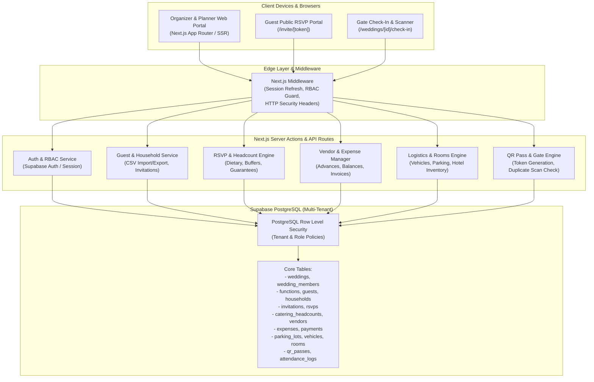

# ShaadiSync — Complete Indian Wedding Management Platform

> **Proprietary Software**  
> Copyright © 2026 Team SHATRUJEET (Amar Khera, Ananya Rout, Lucky Kumar, Omm Prakash Sahoo). All Rights Reserved.  
> Closed-source enterprise SaaS engineering for high-scale, multi-event Indian weddings.

---

## 1. Product Overview

**ShaadiSync** is an end-to-end multi-tenant Indian Wedding Management SaaS platform. Designed specifically to handle the cultural, operational, and financial intricacies of large Indian weddings, ShaadiSync spans multi-day festivities (Mehendi, Sangeet, Haldi, Baraat, Pheras, Reception), diverse guest hierarchies, complex dietary preferences, multi-vendor bookings, dynamic logistics, and on-day gate security.

### Core Value Proposition
- **Multi-Tenant Wedding Isolation:** Robust organisation, workspace, and wedding-level tenancy backed by PostgreSQL Row Level Security (RLS).
- **Indian Wedding Headcount & Catering Engine:** Distinguishes invited guests, confirmed RSVPs, organizer-configured safety buffers, approved caterer guarantees, and real-time physical check-ins.
- **Financial & Monetary Rigor:** Exact rupee (₹) decimal calculations, planned-versus-actual spend tracking, vendor advance & balance reconciliation, preventing accidental double-counting.
- **Guest Portal & Secure Public Invites:** Tokenized, non-guessable invitation URLs for multi-event RSVP submission, household guest responses, dietary requirements, and WhatsApp invite distribution.
- **Logistics & Accommodation:** Real-time parking slot management, airport/station transfer vehicle manifest allocation, and hotel room assignment tracking.
- **Event-Day Gate Operations & Fast Check-In:** High-entropy QR code attendance verification with duplicate-scan warnings, manual override tokens, and operational check-in desks.

---

## 2. System Architecture



---

## 3. Technology Stack

| Layer | Technology | Version / Specification |
| :--- | :--- | :--- |
| **Framework** | Next.js (App Router) | `16.0.7` / React `19.2.0` |
| **Language** | TypeScript | `^5.9.3` (Strict Mode) |
| **Styling & UI** | Tailwind CSS + Lucide React | `^4.0.0` / `^1.16.0` |
| **Database & Auth** | Supabase (PostgreSQL 15+) | `@supabase/ssr ^0.8.0`, `@supabase/supabase-js ^2.48.0` |
| **QR Code Engine** | `qrcode` + Canvas API | `^1.5.4` with Error Correction Level `M` |
| **Testing** | Vitest + Testing Library | `^3.0.0` (Unit, Integration & Security Tests) |
| **Form & Validation** | Server Actions + Native Validation | Server-side Sanitization & CSV Formula Quoting |

---

## 4. Key Functional Modules

### 4.1 Organizations & Multi-Tenant Wedding Management
- Create and administer multiple weddings under isolated organizational workspaces.
- Role-based membership matrix:
  - `owner`: Complete administrative and financial control over the workspace.
  - `admin`: Operational configuration, event scheduling, and team management.
  - `editor`: Guest list updates, RSVP logging, and logistics allocations.
  - `viewer`: Read-only access to schedules and dashboard metrics.
- Database Row Level Security (RLS) ensures zero data leakage across distinct organizations or unauthorized wedding profiles.

### 4.2 Multi-Event / Function Scheduling
- Support for Indian wedding function hierarchies: Sagan, Mehendi, Sangeet, Haldi, Tel Baan, Baraat, Anand Karaj / Pheras, and Reception.
- Function-level datetime scheduling, venue addressing, and targeted guest list assignment.

### 4.3 Household & Guest Directory
- Household grouping for collective family RSVP submissions.
- Guest categorization (`VVIP`, `VIP`, `Bride Side`, `Groom Side`, `Friend`, `Vendor`).
- Per-function invitation assigning.
- Bulk CSV import with row-by-row structural validation and error reporting.
- Sanitized CSV export protected against spreadsheet formula injection attacks (`=`, `+`, `-`, `@`, `\t`, `\r` escaping).

### 4.4 RSVP Engine & Headcount Calculations
- Unique, high-entropy, revocable invitation tokens (`/invite/[token]`).
- Function-specific responses: `attending`, `declined`, `tentative`.
- Accompanying guest management (`plus_one_count`).
- Indian dietary preference tracking (`Pure Veg`, `Jain`, `Non-Veg`, `Eggetarian`, `Halal`, `Vegan`).
- Live headcount derivation:
  $$\text{Proposed Quantity} = \text{Confirmed RSVPs} + \lceil \text{Confirmed RSVPs} \times (\text{Buffer \%} / 100) \rceil$$
- Separation of proposed quantities from organizer-signed caterer guarantees.

### 4.5 Catering & Vendor Management
- Caterer guarantee sign-off with audit logging.
- Multi-category vendor directory (Catering, Photography, Decor, Mehndi Artists, Entertainment, Pandit, Transportation).
- Contract amounts, advances paid, and remaining balance tracking.
- Zero premature conversion: Quoted or planned amounts are never misreported as finalized payments.

### 4.6 Budget & Expense Engine
- Overall wedding budget and per-function budget allocation.
- Detailed expense recording with vendor contract reconciliation.
- Accurate Indian Rupee (₹) financial formatting and variance analysis:
  $$\text{Variance} = \text{Allocated Budget} - \text{Actual Spend}$$

### 4.7 Logistics: Parking, Transport & Accommodations
- **Parking:** Lot capacities, valet operations, driver phone logging, and vehicle slot assignments.
- **Transportation:** Pickup/drop manifests across Airport, Railway Station, and Hotel nodes with vehicle seating constraints.
- **Accommodations:** Hotel inventories, room categorization (Deluxe, Suite, Standard), check-in/out timestamps, and guest room assignments.

### 4.8 QR Passes, Check-in & Gate Operations
- Cryptographically secure 32-character hex QR pass tokens.
- Pass types: `individual`, `household`, `vip`, `vendor`.
- Event-day check-in operator interface with instant scanning, duplicate-scan detection, and manual verification fallback.
- Real-time check-in counters and physical attendance logging.

---

## 5. Security & Multi-Tenant Architecture

1. **Row Level Security (RLS):** Every table enforcing organizational or wedding boundaries (`organization_id` or `wedding_id`) defines explicit Postgres RLS policies based on `auth.uid()`.
2. **Edge Middleware Protection:**
   - Security headers injected on all HTTP responses:
     - `X-Content-Type-Options: nosniff`
     - `X-Frame-Options: DENY`
     - `X-XSS-Protection: 1; mode=block`
     - `Referrer-Policy: strict-origin-when-cross-origin`
     - `Permissions-Policy: camera=(self), microphone=(), geolocation=()`
   - Edge authentication refresh and unauthenticated redirection for protected `/weddings/*` paths.
3. **CSV Formula Injection Mitigation:** All exported spreadsheet cells are scanned and sanitized. Values beginning with dangerous formula triggers (`=`, `+`, `-`, `@`, `\t`, `\r`) are automatically escaped with a leading single quote (`'`).
4. **Secretless Source Code:** Zero secrets, API service-role keys, or private connection strings exist in git history. All environment configurations are loaded from untracked `.env.local` files.

---

## 6. Project Directory Structure

```
c:\PROJECTS\ShaadiSync\
├── docs/                      # Architectural documents, decisions, and progress logs
│   ├── ARCHITECTURE.md        # System design and component interactions
│   ├── DECISIONS.md           # Architectural Decision Records (ADRs)
│   ├── KNOWN_ISSUES.md        # Documented operational constraints and mitigations
│   └── PROGRESS.md            # Verified roadmap phases and audit trails
├── public/                    # Static assets, branding, and icons
├── src/
│   ├── app/                   # Next.js App Router (Layouts, Pages, Server Components)
│   │   ├── (auth)/            # Authentication flows (Login, Register, Signout)
│   │   ├── api/               # API endpoints (Webhooks, exports, tokens)
│   │   ├── invite/[token]/    # Public Guest RSVP Portal
│   │   ├── weddings/          # Authenticated Organizer Workspaces
│   │   │   ├── [id]/          # Wedding-specific workspace
│   │   │   │   ├── budget/    # Budget, expenses & vendor payments
│   │   │   │   ├── catering/  # Catering meal plans & headcount buffers
│   │   │   │   ├── check-in/  # Gate operations & QR scanner desk
│   │   │   │   ├── guests/    # Guest list, households & CSV actions
│   │   │   │   ├── logistics/ # Parking, fleet manifests & hotel rooms
│   │   │   │   ├── passes/    # QR Pass generation & distribution
│   │   │   │   └── vendors/   # Vendor directory & contracts
│   │   │   └── page.tsx       # Wedding selector & onboarding
│   │   ├── layout.tsx         # Root layout
│   │   └── page.tsx           # Product landing page
│   ├── components/            # Reusable React UI Components
│   │   ├── catering/          # Meal plan & headcount widgets
│   │   ├── check-in/          # QR Scanner & check-in operator desk
│   │   ├── guests/            # Guest tables, CSV uploaders, filter bars
│   │   ├── logistics/         # Parking, vehicle, and room allocation forms
│   │   ├── navigation/        # Wedding workspace navigation bars & footers
│   │   ├── passes/            # Printable pass cards & QR canvas
│   │   ├── ui/                # Base design system primitives (buttons, badges, modals)
│   │   └── vendors/           # Vendor cards, payment modals & balance trackers
│   ├── lib/                   # Shared business logic and utilities
│   │   ├── csv.ts             # CSV parsing, generation & formula injection defense
│   │   ├── formatters.ts      # Indian Rupee (₹), date, and phone formatters
│   │   ├── qr.ts              # QR code payload generation & validation
│   │   └── supabase/          # Database client, server client & edge middleware
│   └── types/                 # TypeScript interfaces and Supabase database definitions
├── supabase/
│   ├── migrations/            # Production Postgres SQL migrations with RLS policies
│   └── seed.sql               # Fictional seed data for development & testing
├── tests/                     # Automated Vitest test suites (Unit, Integration, Security)
├── CHANGELOG.md               # Versioned changelog across all 10 roadmap phases
├── package.json               # Package dependencies and NPM build scripts
└── tsconfig.json              # Strict TypeScript compiler options
```

---

## 7. Prerequisites & Environment Setup

### Prerequisites
- **Node.js:** `v20.x` or higher (LTS recommended)
- **NPM:** `v10.x` or higher
- **Supabase Account / CLI:** An active Supabase project with PostgreSQL 15+

### Environment Configuration
Create a `.env.local` file in the project root:

```ini
# Supabase Public API Configuration
NEXT_PUBLIC_SUPABASE_URL=https://your-project.supabase.co
NEXT_PUBLIC_SUPABASE_ANON_KEY=your-supabase-anon-key

# Optional: Supabase Service Role Key (NEVER expose to client; migrations/scripts only)
SUPABASE_SERVICE_ROLE_KEY=your-supabase-service-role-key

# Canonical Web Base URL
NEXT_PUBLIC_APP_URL=http://localhost:3000
```

---

## 8. Database Migrations & Seeding

Migrations are located in `supabase/migrations/` and must be applied sequentially:

```bash
# 1. Initialize Supabase CLI (if running locally)
npx supabase start

# 2. Apply all migrations in order
npx supabase db push

# 3. (Optional) Load realistic test seed data
npx supabase db reset
```

---

## 9. Local Development & Verification

```bash
# Install dependencies
npm install

# Start local Next.js development server
npm run dev

# Run full Vitest automated test suite (81 tests across 11 suites)
npm test

# Run strict TypeScript validation
npm run type-check

# Run ESLint linter
npm run lint

# Compile production build
npm run build
```

---

## 10. Operational Workflows

### 10.1 Guest Import & WhatsApp Distribution
1. Navigate to `/weddings/[id]/guests`.
2. Click **Import CSV** to upload guest records with name, phone, side, and invited events.
3. System runs row-level validation and flags errors without corrupting the database.
4. Generate RSVP links and use the **Copy WhatsApp Message** action to dispatch personalized messages to family heads.

### 10.2 Catering Headcount Sign-off
1. Navigate to `/weddings/[id]/catering`.
2. Select target function (e.g., *Sangeet* or *Reception*).
3. Review confirmed RSVPs, set an organizer safety buffer percentage (e.g., 10%), and inspect calculated quantities.
4. Click **Sign-off Caterer Guarantee** to freeze official plate commitments for caterers.

### 10.3 Event-Day Gate Check-in
1. Navigate to `/weddings/[id]/check-in`.
2. Gate operators can point physical device cameras at guest QR passes or use a 2D barcode handheld scanner.
3. If camera permissions are unavailable, enter the 8-character manual pass token.
4. System validates function eligibility, logs attendance, and immediately flashes visual warnings upon duplicate scan attempts.

---

## 11. Testing & Reliability Matrix

The automated test suite (`vitest`) enforces end-to-end reliability:

| Test Suite | Focus Area | Total Tests |
| :--- | :--- | :---: |
| `tests/auth.test.ts` | Authentication, RBAC matrix, and session validation | 8 |
| `tests/wedding.test.ts` | Multi-tenant wedding creation and workspace scoping | 7 |
| `tests/guests.test.ts` | Guest CRUD, household grouping, and CSV import validation | 9 |
| `tests/rsvp.test.ts` | Tokenized public RSVP submission & dietary persistence | 8 |
| `tests/catering.test.ts` | Headcount engine, safety buffer calculation & guarantees | 8 |
| `tests/budget.test.ts` | Rupee precision, expense categorization & vendor balance reconciliation | 8 |
| `tests/logistics.test.ts` | Parking slot occupancy, vehicle capacity & room inventories | 9 |
| `tests/passes.test.ts` | QR pass generation, token verification & duplicate check-ins | 9 |
| `tests/security.test.ts` | Row Level Security simulation and cross-tenant isolation | 10 |
| `tests/hardening.test.ts` | Formula injection, cross-module scopes & guarantee isolation | 5 |
| **Total** | **All Critical Modules Verified** | **81** |

---

## 12. Troubleshooting & Operational Guide

| Symptom | Root Cause | Resolution |
| :--- | :--- | :--- |
| `PGRST301: JWT expired` | Supabase auth token expired during active session | Refresh page; `middleware.ts` will refresh the session automatically via `@supabase/ssr`. |
| `Check-in camera blocked` | Browser camera permission denied or running on unencrypted HTTP | Grant camera permissions in browser settings, or use `https://` / `localhost`. Alternatively, utilize manual pass token entry. |
| `CSV import rejected rows` | Missing mandatory `name` field or invalid phone format | Review the CSV error modal list; ensure headers match `name,phone,email,category,side,household`. |
| `Catering guarantee mismatch` | Caterer reported higher plates than actual check-in | Inspect `/weddings/[id]/catering` vs `/weddings/[id]/check-in` logs. Catering guarantees are legally binding commitments signed by organizers, distinct from actual physical check-ins. |

---

## 13. Project Team & Ownership

**Team SHATRUJEET:**
- **Amar Khera** — Software Architecture, Full-Stack Engineering, Core Integrations
- **Ananya Rout** — UI/UX Design, Guest Portal, Front-End Systems
- **Lucky Kumar** — Database Engineering, PostgreSQL RLS, Security Policies
- **Omm Prakash Sahoo** — Logistics, Check-In Operations, QA & Verification

---

## 14. License & Proprietary Notice

This software is **CONFIDENTIAL AND PROPRIETARY**.  
Unauthorized copying, transfer, decompilation, distribution, or public display of this software and its source code, via any medium, is strictly prohibited without explicit written permission from **Team SHATRUJEET**.
